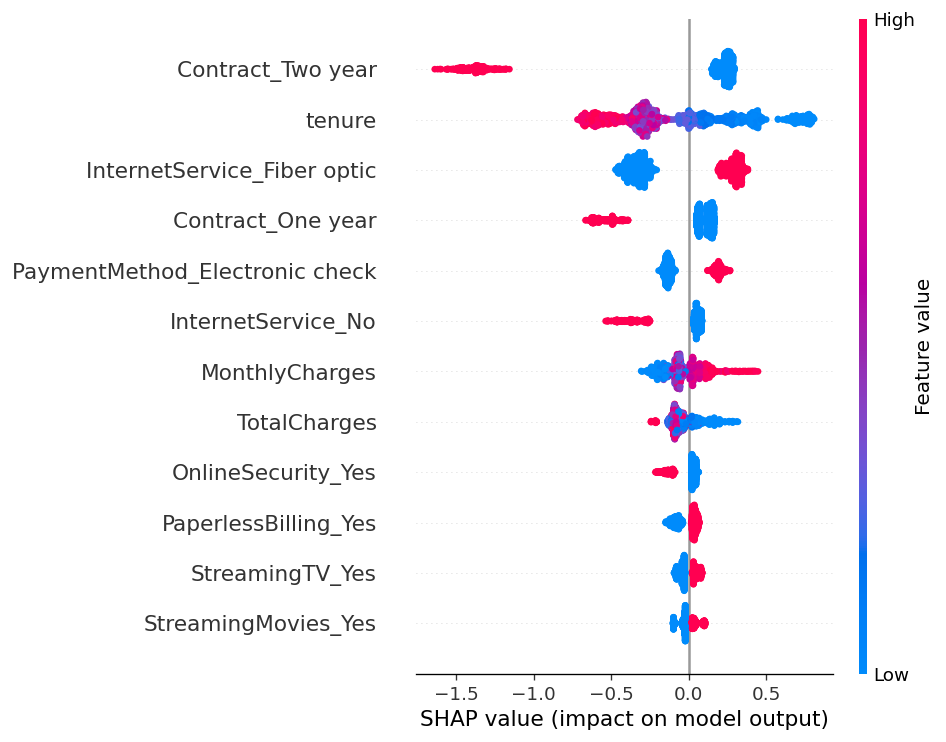

# Customer Churn Prediction

Predicts which telecom customers are likely to cancel, using XGBoost, and explains *why* with SHAP. At a cost-based decision threshold, targeting the model's flagged customers delivers a net value of **[V]** versus **[E]** for contacting everyone.



## Problem

Winning a new customer costs far more than keeping an existing one. If a retention team can't contact everybody, it needs to know who is most likely to leave and what is driving that risk.

## Data

[Telco Customer Churn](https://www.kaggle.com/datasets/blastchar/telco-customer-churn) from Kaggle: 7,043 customers, 20 features (contract, tenure, services, billing, demographics), and a Yes/No churn label (about 26.5% churned). The CSV is not included in this repo. Download `WA_Fn-UseC_-Telco-Customer-Churn.csv` and place it next to the notebook.

## Approach

1. **Cleaning:** `TotalCharges` has blank values for brand-new customers (tenure 0); filled with 0. Dropped `customerID`.
2. **Split:** stratified 60/20/20 train / validation / test, done before any tuning.
3. **Models:** logistic regression baseline, then XGBoost with class weighting for the imbalance and early stopping on validation. 5-fold cross-validation on the training data as a stability check.
4. **Threshold:** chosen on the validation set by maximizing net value under a simple cost model (offer costs 1 unit, a lost customer costs 5, an offer saves 40% of customers who would leave). These costs are **assumptions for illustration**, not real business data.
5. **Test:** evaluated once on the held-out test set.
6. **Explainability:** SHAP values for global drivers and for individual customers.

## Results

| Model | Validation ROC-AUC | Test ROC-AUC |
|---|---|---|
| Logistic regression (baseline) | [ ] | [ ] |
| **XGBoost** | **[ ]** | **[ ]** |

XGBoost test PR-AUC: [ ]. 5-fold CV ROC-AUC: [ ].

**At the chosen threshold ([T]):** recall [ ], precision [ ].

| Strategy | Net value (test set, cost-model units) |
|---|---|
| Contact nobody | 0 |
| Contact everyone | [E] |
| **Contact model-flagged customers** | **[V]** |

## What drives churn (SHAP)

Mean absolute SHAP value of the top features (higher means more influence on the prediction):

| Feature | Mean \|SHAP\| |
|---|---|
| Contract: two year | 0.509 |
| Tenure | 0.361 |
| Internet service: fiber optic | 0.319 |
| Contract: one year | 0.209 |
| Payment method: electronic check | 0.153 |
| Internet service: none | 0.124 |
| Monthly charges | 0.106 |
| Total charges | 0.080 |

Customers on long-term contracts and with long tenure are much less likely to churn, while fiber-optic internet customers and those paying by electronic check are at higher risk. [Add one sentence on what a retention team could do with this, e.g. offering contract-upgrade discounts to month-to-month fiber customers.] SHAP shows which features the model relies on, not what *causes* churn.

## Limitations

- Single dataset of about 7,000 customers with no time dimension, so there is no check on how the model holds up as behaviour shifts.
- The cost model uses invented numbers. Real offer costs, customer lifetime value and save rates would change the best threshold.
- Metrics are measured on one test split (about 1,400 customers), so they carry some uncertainty.
- Predictive patterns are not causal effects. A feature being associated with churn doesn't mean changing it would prevent churn.

## How to run

```bash
git clone [your-repo-url]
cd [your-repo-folder]
pip install -r requirements.txt
jupyter notebook churn_prediction.ipynb
```

Run all cells top to bottom. It writes `results.json`, `eda_churn_rates.png`, `shap_summary.png`, `shap_one_customer.png` and `pr_curve.png`.

## Tech

Python, pandas, scikit-learn, XGBoost, SHAP, matplotlib.
